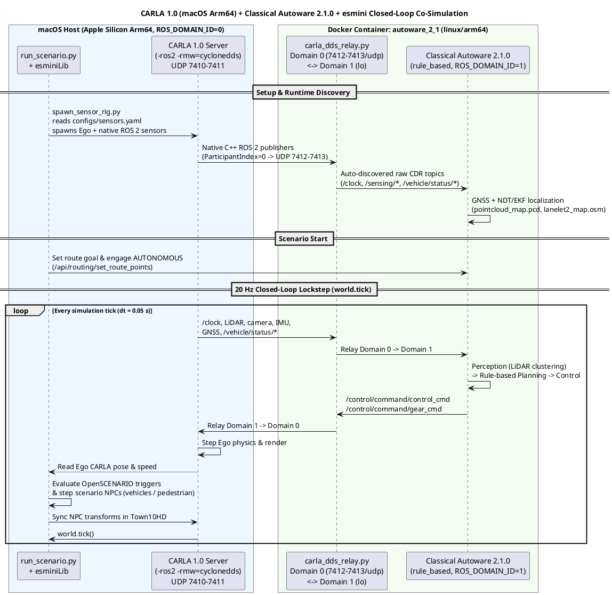
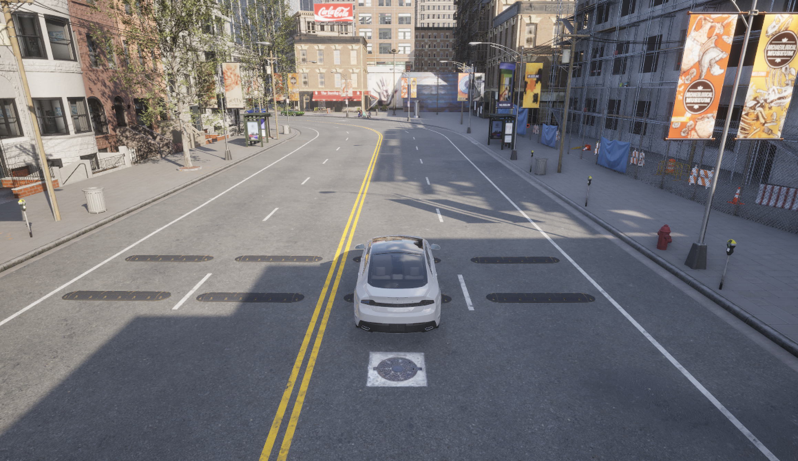

# CARLA 1.0 + Classical Autoware 2.1.0 (macOS Arm64, Native ROS 2, OpenSCENARIO / `esmini`)

This self-contained example demonstrates **CARLA 1.0 on macOS (Apple Silicon `arm64`)** running **closed-loop** against **official Classical Autoware `2.1.0`** (`ghcr.io/autowarefoundation/autoware:universe-jazzy-2.1.0`, `linux/arm64`, ROS 2 Jazzy) inside Docker on the **same machine**—using **CARLA's native C++ ROS 2 + CycloneDDS interface** (no external bridge), a **runtime YAML-configurable sensor rig**, and **ASAM OpenSCENARIO 1.x** orchestrated by **`esmini` (`esminiLib`)** on `Town10HD`.

---

## Architecture & How Closed-Loop + OpenSCENARIO Work



### Key Design Questions Answered

1. **OpenSCENARIO (`.xosc`) & OpenDRIVE (`.xodr`)**:
   Yes—`esminiLib` still requires an OpenDRIVE `.xodr` road network referenced by `<RoadNetwork><LogicFile filepath="../maps/Town10HD/Town10HD_Opt.xodr"/></RoadNetwork>` inside [`scenarios/town10hd_autoware_cut_in.xosc`](scenarios/town10hd_autoware_cut_in.xosc) and [`scenarios/town10hd_autoware_pedestrian_crossing.xosc`](scenarios/town10hd_autoware_pedestrian_crossing.xosc). `esmini` uses `.xodr` for road-relative coordinates (`roadId`, `laneId`, `s`), lane changes, trajectories, and distance triggers, while **CARLA 1.0** performs 3D physics, collision checking, rendering, and native C++ ROS 2 sensor simulation.
2. **Self-Contained `Town10HD` Maps & Scenarios**:
   Both the OpenDRIVE file for `esmini` and the HD maps required by Autoware 2.1.0 live together under [`maps/Town10HD/`](maps/Town10HD/), alongside both `.xosc` scenario files under [`scenarios/`](scenarios/):
   - `Town10HD_Opt.xodr` — OpenDRIVE road network for `esmini`
   - `lanelet2_map.osm` — Lanelet2 vector map for Autoware routing & planning
   - `pointcloud_map.pcd` — 3D point cloud map for Autoware NDT localization
   - `map_projector_info.yaml` — Local cartesian map projector config for Autoware
3. **Who Commands Whom? (`CARLA` vs `esmini` vs `Autoware`)**:
   - **Autoware 2.1.0** drives Ego in closed loop by consuming CARLA's native ROS 2 topics (`/clock`, `/sensing/lidar/top/pointcloud_before_sync`, `/sensing/imu/tamagawa/imu_raw`, `/sensing/gnss/pose_with_covariance`, `/sensing/camera/CAM_FRONT/*`, `/vehicle/status/*`) and sending `/control/command/control_cmd` + `/control/command/gear_cmd` back to CARLA.
   - **`esminiLib` (via [`scripts/run_scenario.py`](scripts/run_scenario.py))** does **not** talk directly to Autoware. Instead, on every 20 Hz `world.tick()`, `run_scenario.py` feeds Ego's live CARLA state into `esminiLib`, evaluates OpenSCENARIO triggers (such as `CutInWhenEgoApproachesEvent` / `LeadAcceleratesWhenEgoClosesGapEvent` or `CrossWhenEgoApproachesEvent` / `StopAfterCrossingEvent`), and updates the scenario NPCs in CARLA. Autoware detects those NPCs purely through CARLA's LiDAR and sensor streams and yields smoothly.
4. **Why the 2-Port CycloneDDS Relay (`7412-7413/udp`)?**:
   On macOS Docker Desktop, `-p` UDP port mappings are proxied by `com.docker.backend`, which drops dynamic ephemeral UDP listeners when ~70+ Autoware nodes initialize across random ports (`ParticipantIndex=auto`). To make cross-VM DDS completely deterministic with just **2 forwarded UDP ports** (`-p 7412-7413:7412-7413/udp`), [`scripts/carla_dds_relay.py`](scripts/carla_dds_relay.py) runs inside the container on `ROS_DOMAIN_ID=0` (`ParticipantIndex=1`, UDP `7412-7413`) and relays raw CDR payloads onto `ROS_DOMAIN_ID=1` over Linux `lo` (`MaxAutoParticipantIndex=200`) where all Autoware nodes communicate cleanly.
5. **Autoware 2.1.0 Runtime Overrides ([`configs/autoware_2_1/`](configs/autoware_2_1/))**:
   `/opt/autoware` inside the official Docker image is kept untouched. [`configs/autoware_2_1/carla_autoware_2_1.launch.xml`](configs/autoware_2_1/carla_autoware_2_1.launch.xml) launches Classical Autoware (`planning_setting:=rule_based`, `lidar_detection_model:=clustering`) with local overrides for:
   - Single-channel LiDAR clustering perception + [`map_based_prediction.param.yaml`](configs/autoware_2_1/map_based_prediction.param.yaml) (`lane_change_path_suppression` parameters required by Autoware 2.1.0)
   - `laserscan_based_occupancy_grid_map` (matching the component library shipped in the `2.1.0` container)
   - [`diagnostics_carla.yaml`](configs/autoware_2_1/diagnostics_carla.yaml) (adding `/autoware/modes/autonomous/available` so `ADAPI` autonomous engagement succeeds cleanly)
   - [`ndt_scan_matcher.param.yaml`](configs/autoware_2_1/ndt_scan_matcher.param.yaml), [`pose_initializer.param.yaml`](configs/autoware_2_1/pose_initializer.param.yaml), [`voxel_grid_filter.param.yaml`](configs/autoware_2_1/voxel_grid_filter.param.yaml)
   - [`static_obstacle_avoidance.param.yaml`](configs/autoware_2_1/static_obstacle_avoidance.param.yaml) (`use_lane_type: "current_lane"`, `target_type.unknown: false`, `avoidance_for_adjacent_lane_stop_vehicle.policy: "ignore"` so single-channel LiDAR clustering noise does not trigger spurious swerves out of Ego's lane)

---

## Prerequisites

- **macOS (Apple Silicon `arm64`)** with **Docker Desktop** running (allocate enough memory, e.g. 8 GB+, and `--shm-size=2g`).
- **Autoware `2.1.0` Arm64 Jazzy image**:
  ```bash
  docker pull --platform linux/arm64 ghcr.io/autowarefoundation/autoware:universe-jazzy-2.1.0
  ```
- **CARLA `1.0` Mac Shipping build** at [`../../Build/Package/Carla-1.0-Mac-Shipping/`](../../Build/Package/Carla-1.0-Mac-Shipping/) (or set `CARLA_ROOT` to another CARLA checkout/package containing `PythonAPI/`).
- **Host Python `3.10`** (the bundled CARLA Mac wheel is `cp310` for `macosx_*_arm64`) with `carla` and `pyyaml` installed (for example with Homebrew Python 3.10 at `/opt/homebrew/opt/python@3.10/bin/python3.10`):
  ```bash
  # From the repository root:
  python3.10 -m pip install Build/Package/Carla-1.0-Mac-Shipping/PythonAPI/carla/dist/carla-*.whl pyyaml
  ```
  (`esminiLib` bindings are already shipped inside `PythonAPI/esmini/`.)

---

## Step-by-Step Quickstart

All host commands below assume you start inside `Examples/Autoware2/`:

```bash
cd Examples/Autoware2
```

> **Note:** On Apple Silicon Macs using Homebrew, substitute `/opt/homebrew/opt/python@3.10/bin/python3.10` if `python3.10` is not on your `$PATH`.

### Step 1 — Generate CycloneDDS Configs & Start the Autoware Container

```bash
python3.10 configs/cyclonedds/generate_dds_configs.py

docker run -d --name autoware_2_1 \
  --shm-size=2g \
  -p 7412-7413:7412-7413/udp \
  -e ROS_DOMAIN_ID=1 \
  -e RMW_IMPLEMENTATION=rmw_cyclonedds_cpp \
  -e CYCLONEDDS_URI=file:///carla_example/configs/cyclonedds/cyclonedds_container.xml \
  -e ROS_AUTOMATIC_DISCOVERY_RANGE=SUBNET \
  -v "$PWD":/carla_example \
  ghcr.io/autowarefoundation/autoware:universe-jazzy-2.1.0 \
  bash -lc "source /opt/ros/jazzy/setup.bash && source /opt/autoware/setup.bash && exec python3 /carla_example/scripts/carla_dds_relay.py"
```

### Step 2 — Start CARLA 1.0 (Native ROS 2) & Spawn the Sensor Rig

In **Terminal 2**, start CARLA `1.0` with native ROS 2 + CycloneDDS enabled:

```bash
cd Examples/Autoware2
RMW_IMPLEMENTATION=rmw_cyclonedds_cpp \
CYCLONEDDS_URI="file://$PWD/configs/cyclonedds/cyclonedds_host.xml" \
ROS_AUTOMATIC_DISCOVERY_RANGE=SUBNET \
../../Build/Package/Carla-1.0-Mac-Shipping/CarlaUnreal.sh \
  Town10HD_Opt -ros2 -rmw=cyclonedds -windowed -ResX=1280 -ResY=720
```

> Use `-RenderOffScreen` instead of `-windowed -ResX=1280 -ResY=720` if you prefer running headless.

Once the CARLA window opens on `Town10HD_Opt`, spawn Ego (`vehicle.lincoln.mkz`) and its configurable sensor rig from **Terminal 3**:

```bash
cd Examples/Autoware2
python3.10 scripts/spawn_sensor_rig.py
```

Expected output of the terminal:

```text
Spawned Ego id=38 (vehicle.lincoln.mkz, role_name='ego')
  CARLA pose : x=27.35, y=137.50, z=-0.07, yaw=0.3 deg
  Active sensors (5 from sensors.yaml):
    - vehicle_status   [sensor.other.vehicle_status] frame='base_link' -> ...
    - velodyne_top     [sensor.lidar.ray_cast] frame='velodyne_top' -> /sensing/lidar/top/pointcloud_before_sync
    - tamagawa_imu     [sensor.other.imu] frame='tamagawa/imu_link' -> /sensing/imu/tamagawa/imu_raw
    - autoware_gnss    [sensor.other.autoware_gnss] frame='gnss_link' -> /sensing/gnss/pose, /sensing/gnss/pose_with_covariance
    - cam_front        [sensor.camera.rgb] frame='CAM_FRONT/camera_optical_link' -> /sensing/camera/CAM_FRONT/image, /sensing/camera/CAM_FRONT/camera_info
```

Expected view in Carla:




### Step 3 — Verify Container <-> CARLA Connection

Check from inside `autoware_2_1` that `/clock` and all native CARLA sensor/status topics arrive cleanly:

```bash
docker exec autoware_2_1 bash -lc 'source /opt/ros/jazzy/setup.bash && source /opt/autoware/setup.bash && python3 /carla_example/scripts/autoware_helper.py check-connection --timeout 8'
```

You should see `[OK]` for `/clock`, `/sensing/lidar/top/pointcloud_before_sync`, `/sensing/imu/tamagawa/imu_raw`, `/sensing/gnss/pose_with_covariance`, `/sensing/camera/CAM_FRONT/image`, `/vehicle/status/velocity_status`, and `/vehicle/status/steering_status`, ending with:

```text
[OK] Bidirectional DDS bridge verified; all required CARLA streams active.
```

### Step 4 — Start Classical Autoware 2.1.0 & Confirm Localization

Launch Autoware `2.1.0` inside `autoware_2_1` (leave this terminal running):

```bash
docker exec -it autoware_2_1 /carla_example/scripts/start_autoware_stack.sh
```

Wait ~30–60 s for the point cloud map, NDT scan matcher, EKF localizer, and planner nodes to initialize:

```text
[OK] Localization INITIALIZED at map pose (25.91, -137.49, -0.01)

======================================================================
 [READY] Classical Autoware 2.1.0 is localized and closed-loop ready.
 Leave this container process running and execute Step 5 on macOS.
======================================================================
```

### Step 5 — Run the OpenSCENARIO Closed-Loop Scenarios

In **Terminal 4** (watching the CARLA window visually), you can run either of the two bundled `Town10HD` OpenSCENARIO scenarios against the running Autoware stack.

> Always respawn Ego with `spawn_sensor_rig.py --xosc <scenario.xosc>` before starting or switching scenarios so Ego starts in that scenario's initial lane (`autoware_helper.py` automatically clears any completed route and re-initializes localization whenever Ego shifts `> 3 m` from EKF).

#### Scenario 1 — Smooth Vehicle Cut-In ([`scenarios/town10hd_autoware_cut_in.xosc`](scenarios/town10hd_autoware_cut_in.xosc))

If you already spawned Ego in Step 2 (which defaults to `scenarios/town10hd_autoware_cut_in.xosc`), you can run `run_scenario.py` directly; otherwise respawn at the left-lane start pose (`roadId="1" laneId="-1"`) first:

```bash
cd Examples/Autoware2
python3.10 scripts/spawn_sensor_rig.py --xosc scenarios/town10hd_autoware_cut_in.xosc
python3.10 scripts/run_scenario.py --xosc scenarios/town10hd_autoware_cut_in.xosc
```

`run_scenario.py` sends a `+90 m` downstream route goal along `laneId="-1"`, engages `AUTONOMOUS`, and steps `esminiLib` + CARLA in 20 Hz lockstep. You will observe:
- Ego accelerating smoothly up to ~15 km/h while staying centered in the left lane (`laneId="-1"`)
- `cut_in_npc` executing a gradual 5.0 s sinusoidal lane change from the right lane (`laneId="-2"`) into Ego's lane (`CutInWhenEgoApproachesEvent`) while Autoware slows smoothly to yield
- `lead_npc` accelerating ahead (`LeadAcceleratesWhenEgoClosesGapEvent`) as Ego follows to the goal with `Collisions: 0`.

#### Scenario 2 — Right-Lane Pedestrian Crossing ([`scenarios/town10hd_autoware_pedestrian_crossing.xosc`](scenarios/town10hd_autoware_pedestrian_crossing.xosc))

Respawn Ego in the **right lane** (`roadId="1" laneId="-2"`) and launch the pedestrian crossing scenario:

```bash
cd Examples/Autoware2
python3.10 scripts/spawn_sensor_rig.py --xosc scenarios/town10hd_autoware_pedestrian_crossing.xosc
python3.10 scripts/run_scenario.py --xosc scenarios/town10hd_autoware_pedestrian_crossing.xosc
```

You will observe:
- Ego accelerating smoothly to ~15 km/h in the right lane (`laneId="-2"`)
- `crossing_pedestrian` stepping off the right sidewalk and walking perpendicular across the road in front of Ego (`CrossWhenEgoApproachesEvent`)
- Autoware detecting the pedestrian via LiDAR, braking to a full stop in lane `-2` to yield, resuming smoothly once the pedestrian clears the lane (`StopAfterCrossingEvent`), and reaching the `+90 m` goal with `Collisions: 0`.

---

## Customizing the Sensor Rig at Runtime (No CARLA Rebuild)

[`configs/sensors.yaml`](configs/sensors.yaml) controls the Ego vehicle blueprint and every CARLA native ROS 2 sensor attached at runtime:

- **Enabled by default (5)**: `vehicle_status`, `velodyne_top`, `tamagawa_imu`, `autoware_gnss`, `cam_front`
- **Pre-configured optional sensors (`enabled: false` by default)**: `cam_front_left`, `cam_front_right`, `cam_back`, `cam_back_left`, `cam_back_right`, and `front_radar` (`sensor.other.radar` -> `/sensing/radar/front_center/detected_objects`)

To add cameras, radar, or change LiDAR/camera parameters (`image_size_x`, `channels`, `points_per_second`, `sensor_tick`, `transform`):

1. Edit [`configs/sensors.yaml`](configs/sensors.yaml) (for example set `enabled: true` under `cam_front_left` or `front_radar`).
2. Re-run `python3.10 scripts/spawn_sensor_rig.py`.

CARLA creates the new native C++ ROS 2 publisher on `/sensing/...` with zero rebuild, and `carla_dds_relay.py` automatically discovers and forwards the new topics into `ROS_DOMAIN_ID=1` inside `autoware_2_1`.

---

## Stopping & Cleanup

```bash
docker exec autoware_2_1 pkill -INT -f "ros2 launch" || true
docker rm -f autoware_2_1
pkill -f CarlaUnreal || true
```
