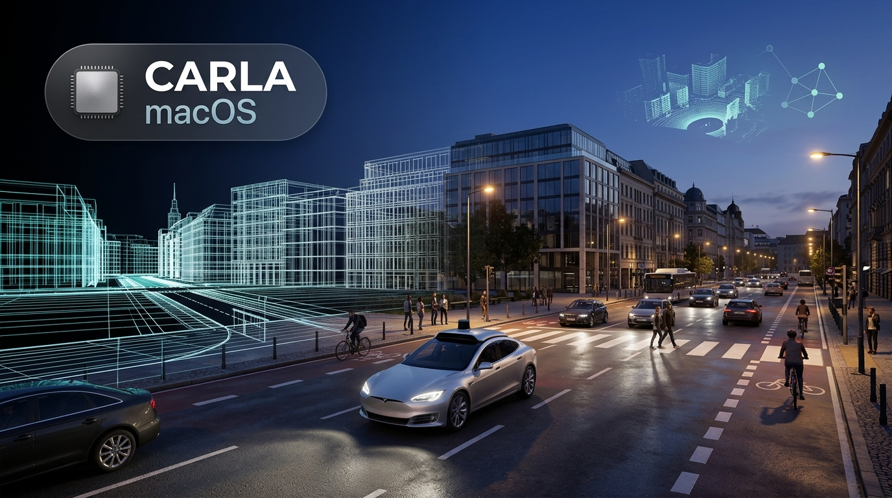

# 🚗 CARLA Simulator — macOS Edition

[](https://github.com/mkhaled87/carla-macos/releases/latest)
[](LICENSE)

**CARLA macOS** (`carla-macos`) is a downstream distribution of the open-source [CARLA Simulator](https://github.com/carla-simulator/carla) ([carla.org](https://carla.org/)), built on **CARLA 1.0 (Unreal Engine 5.8)** to bring first-class simulation natively to **macOS on Apple Silicon (`arm64` / Metal RHI)**. Alongside upstream CARLA's core simulation platform, sensor suite, and open digital assets, this fork adds an **editor-free offline Map Maker (`carla-map`)**, **ASAM OpenSCENARIO (`esmini`) co-simulation**, and **native C++ ROS 2** enabled out of the box.



> [!NOTE]
> This repository tracks **CARLA 1.0** on **Unreal Engine 5.8** (`main` / tag [`1.0`](https://github.com/mkhaled87/carla-macos/releases/tag/1.0)), rebased onto upstream [`carla-simulator/carla`](https://github.com/carla-simulator/carla) release `1.0`. Pre-built **macOS Apple Silicon** release binaries are available on the [Releases page](https://github.com/mkhaled87/carla-macos/releases/tag/1.0).

---

## ✨ What Makes This Release Different

Compared to upstream [CARLA](https://github.com/carla-simulator/carla), **CARLA 1.0 macOS** introduces several major capabilities alongside upstream `1.0` simulator updates:

### 🍎 Native Apple Silicon (`arm64`) & Metal RHI + Ready-to-Run `.app` Release
- Targets **Apple Silicon (`M1`–`M5`)** natively with **Metal RHI** rendering — Rosetta wrappers are not used.
- Includes automated Xcode / Apple Clang compatibility patching (`Util/Patches/UnrealEngine_macOS.patch`) and one-command setup via [`CarlaSetup.sh`](CarlaSetup.sh).
- Published as a ready-to-run **`CarlaUnreal-Mac-Shipping.app`** release package (`CARLA 1.0`, split into GitHub-friendly `<= 2 GB` parts with `SHA256SUMS.txt` verification) so you can run CARLA 1.0 on macOS without compiling Unreal Engine from source.

<details>
<summary>📦 Quick Start: Verifying & Unpacking the Pre-Built macOS 1.0 Release</summary>

Download all `Carla-1.0-Mac-Shipping.tar.gz.part00`–`part08`, `carla-1.0-Mac-release-metadata.tar.gz`, and `SHA256SUMS.txt` files from the [1.0 Release](https://github.com/mkhaled87/carla-macos/releases/tag/1.0), then reassemble, verify checksums, extract, and launch:

```sh
cat Carla-1.0-Mac-Shipping.tar.gz.part* > Carla-1.0-Mac-Shipping.tar.gz
shasum -a 256 -c SHA256SUMS.txt
tar -xzf Carla-1.0-Mac-Shipping.tar.gz
cd Carla-1.0-Mac-Shipping
./CarlaUnreal.sh
```

</details>

### 🗺️ Editor-Free Map Maker (`carla-map`)
- Build, customize, package, and install standalone **`.carlamap.tar.gz`** maps on both **macOS** and **Linux** from OpenStreetMap (`.osm`), OpenDRIVE (`.xodr`), or custom `.obj`/`.gltf` meshes — **without** Epic's Unreal Engine source access or opening the Unreal Editor.
- Compiles in-tree **`OSM2ODR`** into both the `carla` Python wheel and Unreal plugins (`WITH_OSM2ODR`) with zero external runtime dependencies, alongside the standalone `carla-map` CLI, offline pedestrian NavMesh compilation (`RecastBuilder`), procedural PBR buildings, crosswalks, protected cycleways, dynamic street lights & traffic lights, and zero-Z-fighting custom road replacement.
- Read [`Docs/map-maker/README.md`](Docs/map-maker/README.md) or follow the [Munich OSM End-to-End Tutorial](Docs/map-maker/tutorial_munich_osm_e2e.md).

### 🚦 `esmini` OpenSCENARIO Integration (`PythonAPI/esmini`)
- Execute **ASAM OpenSCENARIO 1.x / 1.2 / 1.3 (`.xosc`)** scenarios against a live CARLA server via **`libesminiLib`** (`PythonAPI/esmini/esmini_runner.py`), delegating storyboard logic, conditions, and NPC trajectories to `esmini` while CARLA runs 3D physics, rendering, and sensors.
- Built to pair cleanly with external autonomous driving stacks (such as **Autoware**) driving the Ego vehicle over CARLA's native `-ros2` interface. See [`Docs/esmini-integration/README.md`](Docs/esmini-integration/README.md).

### 🤖 Native ROS 2 Enabled Out of the Box
- **`ENABLE_ROS2=ON`** is enabled by default on both **macOS** and **Linux**, building **`libcarla-ros2-native`** directly into the CARLA server with no external `carla_ros_bridge` process needed.
- Defaults to **CycloneDDS** (`cyclonedds`) for drop-in compatibility with **Autoware** stacks (including macOS host CARLA ↔ Dockerized Autoware), with **Fast-DDS** (`fastdds`) and **Zenoh** (`zenoh`) selectable at runtime via `--rmw=<cyclonedds|fastdds|zenoh>`. See [`Docs/ros2-native/README.md`](Docs/ros2-native/README.md).

### 🔌 Enhanced Unreal MCP Server & Agent Skills
- Improved compatibility with Unreal Engine's **Editor MCP Server** (`http://localhost:6256/mcp`) alongside repository-bundled AI coding agent skills and MCP tooling ([`AGENTS.md`](AGENTS.md), [`Docs/agent_skills.md`](Docs/agent_skills.md), and [`Docs/build_macos.md#enabling-mcp-server-and-ai-toolsets`](Docs/build_macos.md#enabling-mcp-server-and-ai-toolsets)).

---

## 💻 Recommended System

| Platform | CPU / GPU | Memory | Operating System |
| :--- | :--- | :--- | :--- |
| **macOS (Apple Silicon)** | Apple Silicon `M1` / `M2` / `M3` / `M4` / `M5` (native `arm64`, Metal RHI) | **32 GB+** Unified Memory recommended | macOS 14 (Sonoma) or newer |
| **Linux / Windows** | Intel Core i7/i9 (9th–11th gen) or AMD Ryzen 7/9; NVIDIA RTX 3070/3080/3090 / 4090 / 5090+ (**16 GB+ VRAM**) | **32 GB+** RAM | Ubuntu 22.04 / 24.04 or Windows 11 |

> [!NOTE]
> On macOS, native **Apple Silicon (`arm64`) with Metal RHI** is supported (Rosetta wrappers are unsupported). On Linux/Windows, Ubuntu 22.04, Ubuntu 24.04, or Windows 11 is required.

---

## 📚 Documentation

### Fork Guides & Added Features
- 🍎 [Building CARLA on macOS (`Docs/build_macos.md`)](Docs/build_macos.md)
- 🗺️ [Editor-Free Map Maker (`Docs/map-maker/README.md`)](Docs/map-maker/README.md) & [Munich OSM E2E Tutorial](Docs/map-maker/tutorial_munich_osm_e2e.md)
- 🚦 [`esmini` OpenSCENARIO Integration (`Docs/esmini-integration/README.md`)](Docs/esmini-integration/README.md)
- 🤖 [Native ROS 2 & Autoware Integration (`Docs/ros2-native/README.md`)](Docs/ros2-native/README.md)
- 🧠 [Agentic CARLA Skills (`Docs/agent_skills.md`)](Docs/agent_skills.md)

### Core CARLA Reference
- 🚀 [First steps](Docs/start_first_steps.md) ([ReadTheDocs](https://carla-ue5.readthedocs.io/en/latest/start_first_steps/))
- 🐍 [Python API reference](Docs/python_api.md) ([ReadTheDocs](https://carla-ue5.readthedocs.io/en/latest/python_api/))
- 🧱 [Blueprint library](Docs/bp_library.md) ([ReadTheDocs](https://carla-ue5.readthedocs.io/en/latest/bp_library/))
- 🏙️ [CARLA asset catalogue](Docs/catalogue.md) ([ReadTheDocs](https://carla-ue5.readthedocs.io/en/latest/catalogue/))
- 🐧 [Building on Linux (`Docs/build_linux_ue5.md`)](Docs/build_linux_ue5.md) ([ReadTheDocs](https://carla-ue5.readthedocs.io/en/latest/build_linux_ue5/))
- 🪟 [Building on Windows (`Docs/build_windows_ue5.md`)](Docs/build_windows_ue5.md) ([ReadTheDocs](https://carla-ue5.readthedocs.io/en/latest/build_windows_ue5/))
- 🌐 [Upstream CARLA UE5 Documentation](https://carla-ue5.readthedocs.io/en/latest/)

---

## 📄 Paper

This fork builds directly on the work of the original [CARLA Simulator](https://github.com/carla-simulator/carla) team. In acknowledgment of the original project, we encourage all users of **CARLA macOS** to cite their foundational CoRL'17 paper:

_CARLA: An Open Urban Driving Simulator_<br>
Alexey Dosovitskiy, German Ros, Felipe Codevilla, Antonio Lopez, Vladlen Koltun; PMLR 78:1-16
[[PDF](http://proceedings.mlr.press/v78/dosovitskiy17a/dosovitskiy17a.pdf)]
[[Talk](https://www.youtube.com/watch?v=xfyK03MEZ9Q&feature=youtu.be&t=2h44m30s)]

```bibtex
@inproceedings{Dosovitskiy17,
  title = {{CARLA}: {An} Open Urban Driving Simulator},
  author = {Alexey Dosovitskiy and German Ros and Felipe Codevilla and Antonio Lopez and Vladlen Koltun},
  booktitle = {Proceedings of the 1st Annual Conference on Robot Learning},
  pages = {1--16},
  year = {2017}
}
```

---

## 🛠️ Building CARLA 1.0

**CARLA 1.0** in this repository uses **Unreal Engine 5.8** (built against CARLA's Unreal Engine 5.8 fork).

### 1. Clone the Repository

Clone this repository locally from GitHub (use `-b 1.0` for the tagged `1.0` release, or `-b main` for the latest `main` branch):

```sh
git clone -b main https://github.com/mkhaled87/carla-macos.git CarlaUE58
cd CarlaUE58
```

> [!IMPORTANT]
> Building from source requires access to the CARLA fork of **Unreal Engine 5.8**. Link your GitHub account to Epic Games by following [this guide](https://www.unrealengine.com/en-US/ue-on-github), then authorize your Git credentials to download the Unreal Engine 5.8 repository.

### 2. Platform Setup (`CarlaSetup`)

#### 🍎 Building on macOS (Apple Silicon)

CARLA 1.0 supports native Apple Silicon (`arm64`) on macOS with Metal rendering. First, install the Xcode Metal Toolchain and Homebrew tools required for macOS builds as explained in [`Docs/build_macos.md`](Docs/build_macos.md), then run:

```sh
./CarlaSetup.sh
```

This verifies prerequisites, clones CARLA content, clones and builds Unreal Engine 5.8 (with macOS compatibility patches), compiles CARLA, and installs the Python API. You may be prompted for your GitHub credentials to authorize downloading the Unreal Engine repository.

#### 🐧 Building on Linux

Run the setup script from a terminal in the CARLA root directory:

```sh
./CarlaSetup.sh --interactive
```

The setup script prompts for your `sudo` password to install system prerequisites and your GitHub credentials to download the Unreal Engine repository. By default it uses the apt-installed Python 3; pass `--python-root=PATH_TO_PYTHON` (stripping `/python3` from `whereis python3`) to target a custom Python environment.

<details>
<summary>Unattended Linux build instructions</summary>

Store your GitHub credentials in `.bashrc` before running unattended:

```sh
export GIT_LOCAL_CREDENTIALS=username@github_token
sudo -E ./CarlaSetup.sh
```

Or pass credentials inline in the terminal:

```sh
sudo -E env GIT_LOCAL_CREDENTIALS=github_username@github_token ./CarlaSetup.sh
```

</details>

#### 🪟 Building on Windows

Run the batch setup script from the CARLA root directory (unattended mode is not currently available on Windows; administrator privileges and GitHub credentials will be requested when prompted):

```bat
CarlaSetup.bat
```

### 3. Manual CMake Configure, Build & Launch

#### Configure

- **macOS:**
  ```sh
  cmake -G Ninja -S . -B Build --toolchain=$PWD/CMake/Toolchain.cmake -DCMAKE_BUILD_TYPE=Release -DENABLE_ROS2=ON -DCARLA_DLSS_SDK_PATH=disabled
  ```
- **Linux:**
  ```sh
  cmake -G Ninja -S . -B Build --toolchain=$PWD/CMake/Toolchain.cmake -DCMAKE_BUILD_TYPE=Release -DENABLE_ROS2=ON
  ```
- **Windows:**
  ```sh
  cmake -G Ninja -S . -B Build --toolchain=$PWD/CMake/Toolchain.cmake -DCMAKE_BUILD_TYPE=Release
  ```

> [!NOTE]
> If you intend to target a specific Python installation, add both `-DPython_ROOT_DIR=PATH` and `-DPython3_ROOT_DIR=PATH` to the `cmake` configure command above.

#### Build

```sh
cmake --build Build
```

#### Build & Install the Python API

```sh
cmake --build Build --target carla-python-api-install
```

#### Launch the Unreal Editor

```sh
cmake --build Build --target launch
# Or launch directly without checking targets:
cmake --build Build --target launch-only
```

For detailed instructions on building CARLA 1.0 (Unreal Engine 5.8), consult the build documentation for [macOS](Docs/build_macos.md), [Linux](Docs/build_linux_ue5.md), or [Windows](Docs/build_windows_ue5.md).
